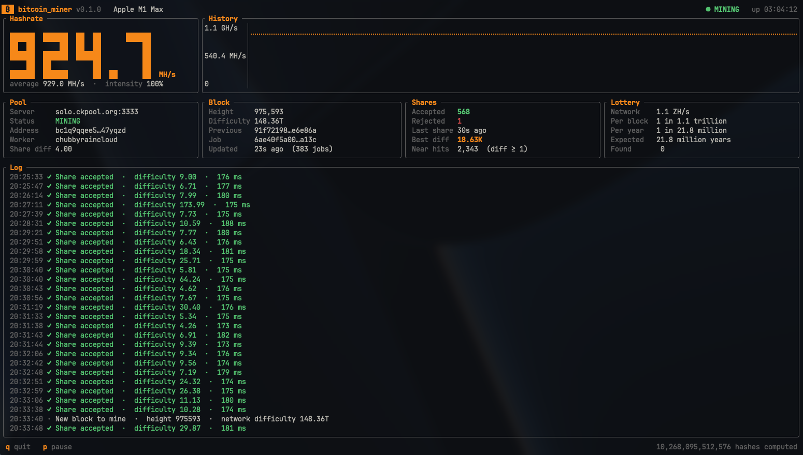

<h1 align="center">Metal Lottery Ticket</h1>

A Bitcoin miner for Apple Silicon GPUs, written in Rust. It hashes on the GPU
through Metal, shows a live terminal dashboard, and is configured with one line
in a `.env` file.



## Is this worth running?

As an investment, no. As a lottery ticket, absolutely.

The honest maths: an M1 Max does roughly 1 GH/s, and the Bitcoin network does
about a trillion times that. On average you'd find a block about once every
twenty million years, and the electricity will cost more than you can expect to
earn. The dashboard shows your live odds, so nothing is hidden.

But averages aren't destiny. Every block is a fresh draw, and every one of your
hashes is a genuine attempt at it — the same lottery the giant mining farms are
playing, just with fewer tickets. Solo miners running tiny hobby rigs *do*
occasionally hit a block, and when it happens the entire block reward (3.125
BTC plus fees, minus the pool's small cut) goes straight to your address. No
splitting it with a pool, no sign-ups, no account.

So leave it running while you work, watch your best share creep upward, and
know that somewhere in those billions of hashes a second there's a tiny chance
of something life-changing. Worst case, you get a fast, readable GPU miner to
poke at and learn from.

## Requirements

- A Mac with Apple Silicon (M1 or later)
- [Rust](https://rustup.rs) 1.88 or newer
- A Bitcoin address to receive the reward

## Quick start

```sh
git clone <this repository>
cd bitcoin_miner
cp .env.example .env        # then put your address in BTC_ADDRESS
cargo run --release
```

Press `q` to quit, `p` to pause or resume, and `Ctrl-L` to redraw the screen.

To see what your GPU can do without connecting to anything:

```sh
cargo run --release -- --benchmark
```

## Configuration

Settings are read from `.env` in the directory you run the miner from (real
environment variables work too). Only the address is required.

| Variable        | Default                | Meaning                                                    |
| --------------- | ---------------------- | ---------------------------------------------------------- |
| `BTC_ADDRESS`   | —                      | Address that receives the reward. Used as the pool login.  |
| `POOL`          | `solo.ckpool.org:3333` | Stratum v1 pool, as `host:port`.                           |
| `WORKER`        | —                      | Optional name for this machine on the pool's dashboard.    |
| `POOL_PASSWORD` | `x`                    | Pool password. Almost every pool ignores it.               |
| `INTENSITY`     | `100`                  | Percentage of time the GPU spends hashing (1–100).         |
| `KERNEL_PATCH`  | `on`                   | `off` runs the compiler's GPU code unpatched (see below).  |

The default pool is a **solo** pool: you only earn something if you find a
block yourself, and then you keep the whole reward minus the pool's fee. Any
other Stratum v1 pool that accepts an address as the login should also work;
`public-pool.io:21496` is another solo option. Pools that require TLS
(`stratum+ssl://`) or an account name are not supported.

Double-check the address. The miner cannot verify it, although ckpool-style
pools refuse to authorize an invalid one and the miner will stop and say so.

### Command-line options

| Option                  | Effect                                                    |
| ----------------------- | --------------------------------------------------------- |
| `--benchmark [SECONDS]` | Measure each kernel's hashrate (10 s each) and exit.      |
| `--headless`            | Print log lines instead of drawing the dashboard.         |
| `--help`, `--version`   | The usual.                                                |

Headless mode is chosen automatically when the output is not a terminal, so
`bitcoin_miner > miner.log` does what you would expect.

## Practical notes

- **Heat and power.** At full intensity the GPU runs flat out. Expect fans, a
  warm machine, and quick battery drain on a laptop. Lower `INTENSITY` to trade
  hashrate for calm; `INTENSITY=50` gives about half the hashrate.
- **Sleep.** macOS will stop the miner when the machine sleeps. Run it under
  `caffeinate -i cargo run --release` to keep the system awake.
- **Desktop responsiveness.** Work is handed to the GPU in ~30 ms slices, so
  the desktop stays usable, though heavy graphics work will feel slower.

## What the dashboard shows

- **Hashrate** — a four-second moving average, plus the average since start.
- **Pool** — the server, connection status and the share difficulty the pool
  asked for. The miner suggests a difficulty that yields a share about every
  twenty seconds; pools may clamp it.
- **Block** — the block being worked on and the network difficulty.
- **Shares** — shares the pool accepted or rejected, the best difficulty any of
  your hashes has reached, and "near hits": hashes that met difficulty 1,
  whether or not the pool wanted them.
- **Lottery** — your chance of solving a block at the current hashrate. A block
  is found when a share's difficulty reaches the network difficulty.

## How it works

A Bitcoin block header is 80 bytes and is hashed as `SHA256(SHA256(header))`.
Mining means changing the 4-byte nonce at the end of the header until that hash,
read as a number, falls below the network target. When all 2³² nonces are used
up (about every 8 seconds on an M1 Max, which tries each nonce under two header
versions when the pool allows it) the miner changes the `extranonce2`
field inside the coinbase transaction, which changes the merkle root and gives a
fresh header to search.

| Module            | Role                                                                    |
| ----------------- | ----------------------------------------------------------------------- |
| `src/gpu/`        | Metal backend, the SHA-256d search kernel (generated MSL), its patcher  |
| `src/work.rs`     | Header assembly, targets, per-header precomputation                     |
| `src/stratum.rs`  | Stratum v1 client with reconnect and backoff                            |
| `src/miner.rs`    | Feeds the GPU, verifies candidates on the CPU, submits shares           |
| `src/ui/`         | ratatui dashboard and headless output                                   |
| `src/sha256.rs`   | SHA-256 with an exposed compression function                            |
| `src/config.rs`   | `.env` parsing                                                          |

### The kernel

Each GPU thread computes one double hash. A full double hash is three SHA-256
compressions (192 rounds); the kernel computes about 121 of them:

- **Midstate.** The first 64 header bytes do not contain the nonce, so their
  compression is done once per header on the CPU.
- **Skipped rounds.** The nonce is the fourth word of the second block, so the
  first three rounds of that block are also done on the CPU, and the fourth
  collapses to two additions.
- **Folded message schedule.** Most of the remaining input is fixed padding.
  Schedule words that do not depend on the nonce are precomputed and zero terms
  are dropped.
- **Early exit.** A hash can only meet difficulty 1 if its last 32-bit word is
  zero, and that word is fixed four rounds before the end, so the final three
  rounds are never computed.
- **Constants in uniform registers.** The GPU is limited by how many
  instructions it can issue, and a 32-bit literal costs an extra instruction to
  load. The round constants are passed in the parameter buffer instead, which
  the GPU keeps in registers every instruction can read for free.
- **Paired lanes.** If the pool allows version rolling (BIP 310/320, which most
  pools do), neighbouring GPU threads hash the same nonce under two header
  versions. The version only affects the first block, so both threads need the
  same message schedule for the second; each computes every other word and
  they swap results through the SIMD shuffle network. That saves about 4%.
  Without version rolling the miner uses a one-thread-per-nonce kernel.

Nonces that pass this 32-bit test (about one in 4.3 billion) are returned to the
CPU, which recomputes the full hash and compares it with the pool and network
targets. Two dispatches are kept queued so the GPU never waits for the CPU.

### Patching the compiled code

Apple's shader compiler turns each rotate into an `extr` (extract from a register
pair) and, before rotating a value, copies it into a second register so the
instruction never reads the same register twice. The GPU does not need that:
`extr` reading one register twice is a correct rotate. In a kernel limited by
how many instructions it can issue, those ~650 copies per hash cost about 5%.

So at start-up the miner has a child process compile the kernels into a Metal
binary archive, removes the copies from the GPU machine code itself, and builds
its pipelines from the patched archive. The patcher (`src/gpu/patch.rs`) only
touches code it fully understands:

- every instruction must decode to a known encoding (a table generated from
  [applegpu](https://github.com/dougallj/applegpu), Dougall Johnson's
  reverse-engineered description of the M1 GPU) and be one these kernels use;
- a copy is removed only if every later read of it is the second source of a
  rotate of the same register, and nothing in between is unmodelled;
- a tiny canary kernel, patched too, proves Metal is running the patched code
  rather than a cached compile.

If any of that fails, or the patched kernels fail the self-test below, the miner
uses the compiler's code unchanged and says why. `KERNEL_PATCH=off` forces that.
Since it relies on undocumented details of Apple's GPU, a future macOS may well
make the patch stop applying; mining continues either way.

At start-up both kernels must find the nonce of the genesis block (the paired
one in either lane), so a miscompiled or misbehaving GPU is caught before any
mining starts.

### Performance

| Machine              | Single lane | Paired lanes |
| -------------------- | ----------- | ------------ |
| M1 Max (32-core GPU) | ~998 MH/s   | ~1.05 GH/s   |

Numbers for other chips are welcome — run `--benchmark` and open a pull request.

## Development

```sh
cargo test      # SHA-256 vectors, header assembly against real blocks, layout tests
cargo clippy --all-targets
python3 -I tools/gen_agx_table.py PATH_TO_APPLEGPU > src/gpu/agx_table.rs  # regenerate
```

The tests cover the CPU side. `--benchmark` runs the GPU self-test.

## Limitations

- Stratum v1 over plain TCP only: no TLS, no Stratum v2, no `getblocktemplate`.
- Uses the system's default Metal device; there is no multi-GPU support.

## License

MIT — see [LICENSE](LICENSE). `src/gpu/agx_table.rs` and the instruction
layouts in `src/gpu/agx.rs` are derived from
[applegpu](https://github.com/dougallj/applegpu) (BSD-3-Clause, Dougall
Johnson); its licence is reproduced in that file.
